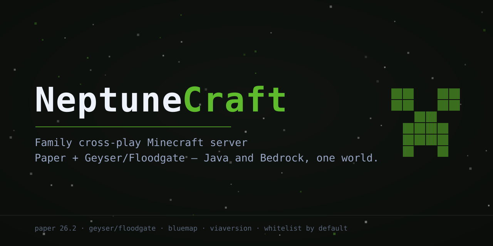
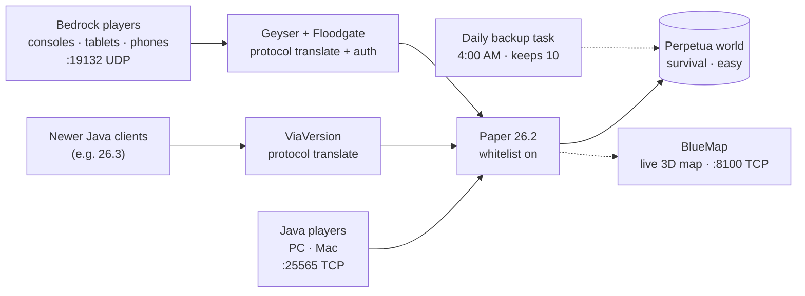

[](https://papermc.io)
[](https://www.minecraft.net)
[](https://adoptium.net)
[](#connecting)
[](LICENSE)

**NeptuneCraft** — a family cross-play Minecraft server. One survival world
(**Perpetua**), Java and Bedrock players side by side: PC, consoles, tablets,
and phones all join the same game.

Paper 26.2 does the heavy lifting, Geyser + Floodgate translate Bedrock
players in (no Java account needed for them), ViaVersion lets newer Java
clients join, BlueMap renders a live 3D web map of the world, and a scheduled
task backs the whole thing up every night. Whitelist is on from the first
boot — family only.

## Features

- **True cross-play** — Java Edition (`:25565` TCP) and Bedrock (`:19132` UDP)
  join the same world. Geyser translates the protocol; Floodgate lets Bedrock
  players in without owning Java Edition.
- **ViaVersion** — newer Java clients (e.g. 26.3) can join the 26.2 server, so
  a launcher auto-update never locks anyone out.
- **Whitelist on by default** — the server is family-only from the first boot,
  which matters because it gets port-forwarded to the internet.
- **BlueMap live 3D map** — the world rendered to an interactive browser map
  (`:8100` TCP), updating as you build. Handy for planning a mega-base.
- **Automatic daily backups** — `setup-backup-task.ps1` registers a 4:00 AM
  scheduled task; `backup.ps1` zips worlds + configs and keeps the 10 newest.
- **Sane family-server defaults** — survival, Easy difficulty, 20 max players,
  view/simulation distance 10, 8G RAM default.
- **Pinned everything** — Paper, Geyser, Floodgate, BlueMap, and ViaVersion
  are pinned to builds verified working together; `install.ps1`/`install.sh`
  fetch them idempotently.

## Quick start

The full runbook is **[WINDOWS_SETUP.md](WINDOWS_SETUP.md)** — Java install,
world move, LAN + remote join, port forwarding, whitelist, backups, and the
keep-awake checklist for the host PC. The short version:

```powershell
git clone https://github.com/Skeleten80/minecraft-server.git
cd minecraft-server
# right-click install.bat -> Run as administrator (downloads pinned jars)
# double-click start.bat (first boot generates configs)
```

Then move the Perpetua world in (backup first, copy the folder, set
`level-name` in `server.properties`), and share **[FAMILY_JOIN.md](FAMILY_JOIN.md)**
with everyone joining.

> **Version check:** the server runs Minecraft **26.2**. Java clients are best
> on 26.2 (newer ones work via ViaVersion), and the world itself must have
> been last saved in 26.2 or older — Paper can't open a newer world.

## Architecture



## The stack

| Piece | Version | What it does |
|---|---|---|
| Paper | 26.2 build 129 (stable) | Server software — vanilla gameplay, much better performance than Mojang's jar |
| Minecraft Java | 26.2 | The game version the server runs (requires Java 25+) |
| Geyser | 2.11.3 build 1247 | Translates between Bedrock and Java protocols (emulates Java 26.2) |
| Floodgate | 2.2.5 build 141 | Lets Bedrock players join **without** owning Java Edition |
| ViaVersion | 5.12.2-SNAPSHOT+1103 | Lets newer Java clients join this 26.2 server |
| BlueMap | 5.29 (paper) | Live 3D web map of the world at `http://<server>:8100` |

All six are pinned to builds verified working together. Paper 26.2 is the
stable line; Minecraft 26.3 exists but Geyser has no 26.3 build yet — so
everyone plays on **26.2**.

## Connecting

| Port | Protocol | For |
|---|---|---|
| 25565 | TCP | Java Edition players |
| 19132 | UDP | Bedrock players (Geyser) |
| 8100 | TCP | BlueMap web map (optional forward) |

**Java Edition:** Multiplayer → Add Server → `<server-ip>:25565`. Best on
release 26.2; newer clients join via ViaVersion.

**Bedrock (Xbox, PlayStation, Switch, iOS, Android, Windows):** Play →
Servers → Add Server → address `<server-ip>`, port `19132`. Bedrock updates
itself; Geyser tracks current Bedrock releases.

**Floodgate note:** Bedrock players appear in-game with a `.` prefix
(e.g. `.Mathias`) and don't need a Java account — but Java players still sign
in with their Microsoft accounts as usual (`online-mode=true` stays on).

**Whitelist:** on from the start. In the server console:
`whitelist add <exact player name>`. Bedrock names aren't known until the
first join attempt — the console logs the rejected name verbatim, then add it
and have them rejoin.

**Making yourself admin:** in the console, `op YourJavaUsername`
(Bedrock: `op .YourBedrockName`).

## Backups

`backup.ps1` (or `backup.sh`) zips the world folders + configs into `backups/`
with a timestamp and keeps the 10 newest. Run it while the server is stopped —
or type `save-all` in the console first.

For a world you plan to keep for years, register the daily task (Windows, run
once as Administrator):

```powershell
powershell -ExecutionPolicy Bypass -File setup-backup-task.ps1
```

Then copy the newest `backups\backup-*.zip` off the machine now and then —
same-drive backups don't survive a dead drive.

## Files

```
install.sh / install.ps1 (+ install.bat)   download pinned jars (one time, pick your OS)
start.sh   / start.ps1   (+ start.bat)      launch the server (foreground)
backup.sh  / backup.ps1                     timestamped backup of worlds + configs
setup-backup-task.ps1      registers the daily 4 AM backup task (Windows, run once as admin)
server.properties          server settings (whitelist on, survival, easy)
eula.txt                   Mojang EULA acceptance
paper.jar                  (downloaded) Paper server
plugins/
  Geyser-Spigot.jar            (downloaded) Bedrock bridge
  Floodgate-Spigot.jar         (downloaded) Bedrock auth
  bluemap-5.29-paper.jar       (downloaded) Live 3D web map (port 8100)
  ViaVersion-5.12.2-SNAPSHOT.jar (downloaded) Newer Java clients can join
  Geyser-Spigot/config.yml     Bedrock listener config (port 19132, Floodgate auth)
backups/                   your backups land here
```

`plugins/floodgate/key.pem` is generated automatically on first boot — it's this
server's identity key, don't share or delete it.

## Going further (when vanilla gets old)

Drop plugin jars into `plugins/` and restart. Good first additions:

- **LuckPerms** — permissions/ranks
- **CoreProtect** — block logging + rollback griefing
- **Chunky** — pre-generate the world so exploring doesn't lag (`chunky start`)

## License

MIT — see [LICENSE](LICENSE).
